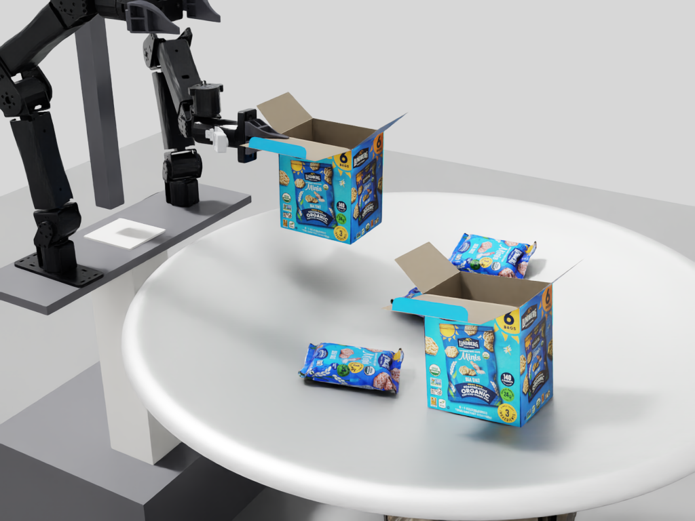

# Titus Packing Benchmark · Alpha

**A dual-arm packing environment, robot teleoperation demonstrations, and handheld UMI demonstrations for manipulation research.**

[Scene assets & collection](https://huggingface.co/collections/titus-robots/titus-packing-benchmark-alpha-6ae40831f2ed5265df24161f) · [Teleop data](https://huggingface.co/datasets/titus-robots/rotary-table-rice-cakes) · [UMI data](https://huggingface.co/datasets/titus-robots/trumi-box-bags-2026-10-16) · [Dataset guide](docs/DATASETS.md)


*Existing SDK render illustrating the robot, dish, bags, and cartons. This image is not a policy-success result or the six-bag starter reset.*

## Code here, assets and demonstrations on Hugging Face

| Component | Location |
|---|---|
| Scene API, backends, controllers, scorers, recipes, tests, and documentation | This GitHub repository |
| USD scenes, meshes, textures, collision/tetrahedral data, optional factory background | [Titus scene assets](https://huggingface.co/datasets/titus-robots/titus-packing-benchmark-alpha) |
| Exact Linux/Python 3.12 solver dependency snapshot | Separate `titus-runtime-v0.2.0.zip` download in the scene-asset repository |
| Robot teleop: 60 segments / 162,143 frames at 60 Hz | [Existing LeRobot dataset](https://huggingface.co/datasets/titus-robots/rotary-table-rice-cakes) |
| UMI: 21 retained bimanual episodes / 471 seconds | [Existing UMI dataset](https://huggingface.co/datasets/titus-robots/trumi-box-bags-2026-10-16) |

Release **alpha-v0.2.0** separates code from large payloads. `assets.lock.json` pins the exact Hugging Face commit, archive hashes, and every asset/dependency file hash. Physics code and physical assets are unchanged from the previous alpha and scene SDK **2026.10.28.8**. The only new executable component is the download-and-verification utility.

The scene assets are public. The two existing demonstration datasets retain their access-approval settings, original data, and MIT licenses. They are not downloaded by the scene setup command.

## Quick start

Use Python **3.10+** for downloading and the lightweight SDK client. Native simulation requires **Linux x86-64, an NVIDIA GPU, and a separately installed pip-based Isaac Sim 6.2.0.0 environment with Python 3.12**. macOS can inspect assets and run CPU checks but cannot execute the supplied native simulator. [Full setup](docs/SETUP.md).

```bash
git clone --branch alpha-v0.2.0 https://github.com/ewinchell07/titus-packing-benchmark.git
cd titus-packing-benchmark
python3 -m venv .venv
source .venv/bin/activate
python -m pip install -r requirements-client.txt

# Downloads the pinned scene assets and exact solver dependency snapshot.
python scripts/fetch_assets.py
python verify_package.py

# Point to your separately provisioned Isaac Sim environment.
export ISAAC_PYTHON=/absolute/path/to/isaac-environment/bin/python
python -m titus setup --backend soft
python -m titus reference --backend soft --out runs/reference_soft
```

The supplied reference is a **privileged, scripted single-bag installation check**. It is not a learned policy or a six-bag benchmark result.

Generate the starter task and exercise the policy interface:

```bash
# Scene generation only; no physics is started.
python -m titus populate recipes/alpha_six_bags_one_carton.json \
  --backend soft --seed 42 --bags 6 --boxes 1 --out runs/scene_42

# Placeholder policy holds current targets. Replace policy() in the example.
python -m examples.randomized_policy \
  --recipe recipes/alpha_six_bags_one_carton.json \
  --backend soft --seed 42 --bags 6 --boxes 1 --out runs/first_policy
```

Use a fresh output directory each time. For rigid-only work, `python scripts/fetch_assets.py --component scene` skips the solver snapshot; use `--backend rigid` in the native commands. Full `verify_package.py` expects both components. For offline installation, place the two exact release ZIPs in a directory and run `python scripts/fetch_assets.py --offline-dir /path/to/downloads`.

## Connecting a policy

`Scene` exposes `observe`, `step`, `move`, `solve_ik`, `render_views`, and `reset`. `PolicyRunner` supplies RGB camera paths and robot proprioception to a callback and records actions and timing. Start from `examples/randomized_policy.py`; keep your model environment separate from Isaac Sim.

- **Units:** metres and radians, Z-up. Physics is 600 Hz; 10 ticks = 60 Hz and 20 ticks = 30 Hz.
- **Grippers:** `opening_m` is travel per finger, not full jaw width. Nominal jaw gap is `0.0060894 + 2 * opening_m`.
- **Cameras:** external 1024×768; left/right wrists 256×256. Wrist optics are simulation settings, not measured hardware calibration. [Camera details](docs/CAMERAS.md).
- **Observations:** `Scene.observe()` includes privileged truth for diagnostics. Ordinary `PolicyRunner` callbacks receive camera/proprioception inputs; keep truth out of learned-policy observations.
- **Timing:** `freeze` pauses during inference; `held_command` advances under the previous target for measured inference time. The bundled runner excludes rendering and IPC. Record timing mode and action cadence when comparing results.

## Tasks and scoring

The alpha starter uses six bags, one carton, and **no automatic carton-hold initialization**. The upstream randomized recipe and fixed reference have different defaults. Generated seeds are not all validated for reachability or successful packing.

The bundled `PlacementEvaluator` uses assigned-carton containment, release/contact/support checks, low speed, and a **two-second sampled stable dwell**. The single-bag reference has additional task-specific conditions. This release does not ship the separate development campaign's open-top scorer, reachable-layout admission, or experimental controller/solver settings. [Evaluation contract](docs/EVALUATION.md).

## Data and practical tips

Read [the dataset guide](docs/DATASETS.md) for pinned revisions, download commands, camera order, action formats, and splitting recommendations.

- Teleop is three-view 480×270 fisheye data at 60 Hz with 14 absolute joint values. Map joint order and finger units explicitly; do not assume it matches a model's native embodiment.
- UMI is two-camera end-effector poses and gripper widths in a mapping-tag frame. Validated registration into YAM, bimanual retargeting, and treatment of the missing third view remain integration work.
- Keep source recordings together when making train/test splits. Compute normalization on training data only.
- Start with one bag to check action mapping and cameras, then scale counts or recipe variation.
- The optional factory Gaussian splat changes appearance only. It supplies no collisions or support and is disabled by default. [Background setup](docs/BACKGROUND.md).
- Preserve native physics guards. Deformable-body collapse/inversion can occur during manipulation; record those episodes as simulation-invalid and retain the failure evidence.

## Alpha status and validation

This is an environment-and-data alpha, not a frozen leaderboard. Known limits include soft-contact instability, approximate simulation cameras, one bag SKU and one carton representation, provisional placement geometry, and incomplete UMI-to-robot registration. A successful reference or short replay does not establish broad physical stability or sim-to-real fidelity. [Alpha notes](docs/ALPHA_NOTES.md).

Packaging validation covers exact source/asset hashes, CPU tests, the policy contract, and rigid/soft scene generation and USD dependencies. No fresh GPU qualification is claimed for the split release. See `validation.json`.

```bash
python -m unittest discover -s tests -p 'test_*.py'
python -m tests.check_policy_contract
```

Contributions are welcome through GitHub issues and pull requests: adapters, measured calibration, UMI retargeting, reproducible physics fixes, assets with provenance, and explicit evaluation protocols. [Contributing](docs/CONTRIBUTING.md).

## License and provenance

Titus code, documentation, and Titus-owned assets are **MIT licensed**. Third-party components retain their licenses and trademark rights are unchanged; Isaac Sim is installed separately. See [LICENSE](LICENSE) and [third-party notices](THIRD_PARTY_NOTICES.md).

`release.json` identifies the source SDK and dataset revisions. Earlier combined alpha snapshots remain available at their Hugging Face release tags; this split release is the primary setup path.
